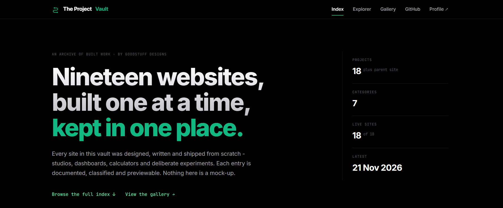
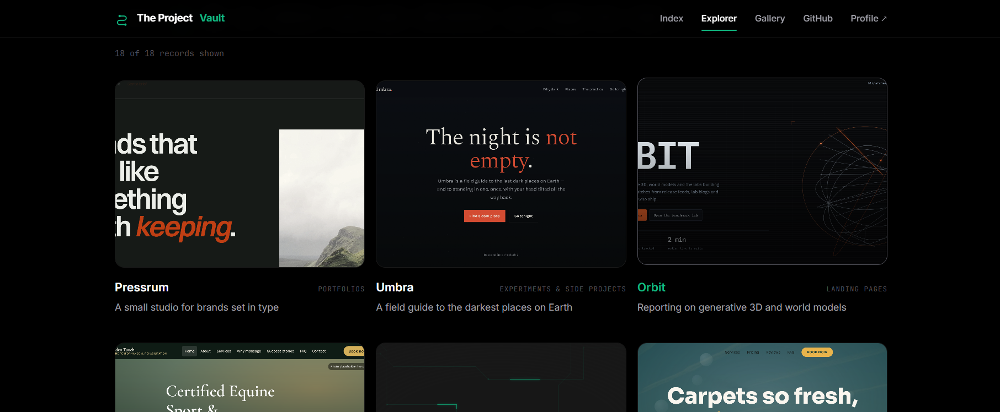
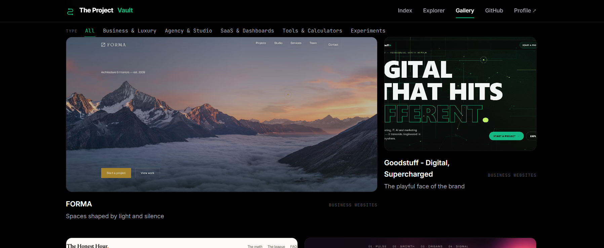
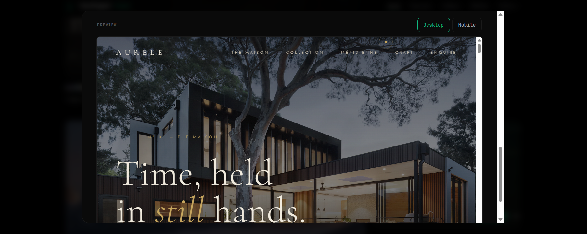
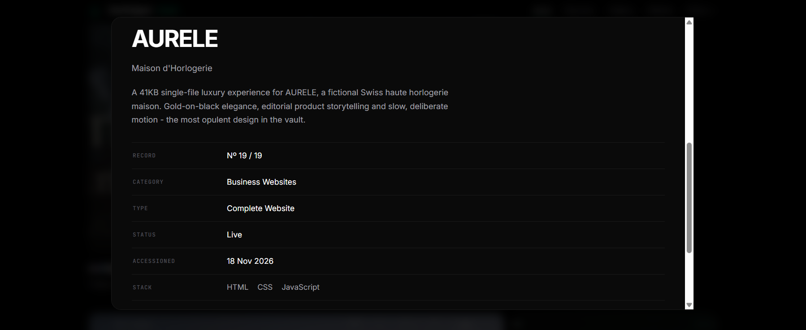

<div align="center">


# The Project Vault

**An archive of built work — nineteen real websites, indexed, documented and previewable from a single static page.**

[](https://code-namecode.github.io)
[](https://github.com/Code-NameCode)
[](#technology-stack)
[](#technology-stack)
[](#technology-stack)
[](data/projects.json)
[](#installation-and-setup)
[](#)

</div>

---

## Table of Contents

- [Why this exists](#why-this-exists)
- [Screenshots](#screenshots)
- [Features](#features)
- [Technology Stack](#technology-stack)
- [Installation and Setup](#installation-and-setup)
- [Project Architecture](#project-architecture)
- [Configuration and Usage](#configuration-and-usage)
- [Development Guide](#development-guide)
- [Data Reference](#data-reference)
- [Performance Considerations](#performance-considerations)
- [Known Limitations](#known-limitations)
- [FAQ](#faq)
- [Credits](#credits)

---

## Why this exists

**The Project Vault** is a self-updating archive of real, shipped websites — studios, dashboards, calculators and deliberate design experiments — built by [Goodstuff Designs](https://www.goodstuffdesigns.co.za), a South African IT and web business.

The problem it solves is a common one: work gets built, deployed, and then quietly scattered across old folders, defunct staging servers and forgotten bookmarks. The Vault fixes that with one durable artifact — a static, dependency-free index that lives next to the work itself. Every entry is documented, classified and previewable directly from the browser.

It is designed for:

- **The maintainer**, as a living portfolio that survives hosting changes and link rot.
- **Clients and collaborators**, as a single page that proves what was built and lets them click through to it.
- **Anyone learning front-end**, as a study set: every project's source sits in the same repository, and each record links straight to the files.

What makes it different: there is no CMS, no framework, no build step, and no backend. The entire archive is one `projects.json` file and one vanilla-JS single-page app — small enough to read top-to-bottom, durable enough to outlive any tooling trend.

---

## Screenshots

**Home** — editorial opening with live archive stats, featured parent site, numbered recent-accessions ledger and the full plate wall.



**Explorer** — searchable, filterable index of every record with live result counts.



**Gallery** — the collection regrouped by type: business and luxury, agency and studio, SaaS and dashboards, tools, experiments.



**Record modal & live preview** — each plate opens a full project record; the actual site loads in an iframe with a desktop/mobile toggle.





Every project card in the archive itself *is* a real screenshot — each entry in `data/projects.json` points at a full-page capture stored alongside the project's source in `ProjectSetOne/` and `ProjectSetTwo/`.

---

## Features

### Archive and discovery

- **Hash-routed single-page app** with four views — `#/` (index), `#/explorer`, `#/gallery`, `#/github` — that updates the URL without reloads and restores state on navigation.
- **Explorer** with live search across name, tagline, description, category, type and technology, plus independent category and technology filters, five sort orders, and a live "N of M records shown" counter.
- **Gallery** that re-groups the same data by collection type (Business & Luxury, Agency & Studio, SaaS & Dashboards, Tools & Calculators, Experiments) using a dedicated filter map.
- **Category index** on the home view with per-category counts that deep-link into a pre-filtered Explorer (passed via `sessionStorage`, so filters survive the route change).
- **Numbered "recent accessions" ledger** — the six newest projects, presented as a catalogued list with record numbers and accession dates.

### Project records

- **Detail modal for every project** — cover image, tagline, full description, record number, category, type, status, accession date and technology chips.
- **File-level contents list** per project: real files render as working links into the repository; folder summaries like `assets/ (9 images)` stay plain text (linking bare folders would 404 on GitHub Pages).
- **Live preview on demand** — the modal embeds the actual project in an iframe, with a desktop/mobile viewport toggle. Previews load only when requested, keeping the initial page lightweight.
- **Private/parent entries** — a project flagged `"private": true` (the Goodstuff Designs flagship site) appears only in the Featured plate, never in the wall, Explorer, or gallery, and links to its live URL instead of a repo preview.

### Interface and resilience

- **Scroll-reveal animations** with per-element stagger and a 2.5-second failsafe so content can never remain hidden if the IntersectionObserver misfires.
- **GitHub integration** — repository cards fetched live from the GitHub REST API, cached in `localStorage` for 30 minutes, with graceful degradation on rate limits (falls back to cached data, then to a clear notice).
- **Responsive and accessible** — fixed blurred masthead, mobile menu, skip-to-content link, `:focus-visible` rings, aria labels on all interactive controls, Escape closes the modal.
- **Graceful failure everywhere** — if `projects.json` can't be fetched (e.g. opened via `file://`), every affected section shows an actionable notice instead of a blank page; nav wiring attaches before data loads so the menu works even on failure.

---

## Technology Stack

| Layer | Choice | Notes |
|---|---|---|
| Markup | **HTML5** | Single semantic `index.html` with all four views server-side present |
| Behaviour | **Vanilla JavaScript (ES2020+)** | ~466 lines, no frameworks, no transpilation, one delegated click listener |
| Styling | **Modern CSS** | Custom properties, `clamp()`, grid, backdrop-filter, `:focus-visible` |
| Typography | **Inter + JetBrains Mono** | Google Fonts, self-hosted via `<link>` |
| Data | **JSON** | `data/projects.json` — 19 project records + site config |
| APIs | **GitHub REST API v3** | Optional, cached, rate-limit safe |
| Hosting | **GitHub Pages** | Deployed from the repository root |
| Icons | Inline SVG | Logo and favicon only; no icon library |

No npm, no bundler, no test runner, no CI. The absence is deliberate — see [Known Limitations](#known-limitations).

---

## Installation and Setup

### Prerequisites

- Any modern browser.
- A local static file server for development (the app fetches JSON, so `file://` won't work). Any of: `npx serve`, `python -m http.server`, VS Code Live Server, or the PowerShell IIS Express handler.

### Run locally

```bash
# clone
git clone https://github.com/Code-NameCode/<this-repository>.git
cd <this-repository>

# serve with Node (no install needed beyond npx)
npx serve .

# or with Python
python -m http.server 8000
```

Then open `http://localhost:3000` (serve) or `http://localhost:8000` (Python).

### Deploy to production

The site deploys as-is with zero build steps:

1. Push `main` to GitHub.
2. Settings → Pages → Source: **Deploy from a branch**, branch `main`, folder `/ (root)`.
3. Done. Paths are computed at runtime (`withBase()`), so the site works from a project page (`/repo-name/`) as well as a user page root. For external hosting at a sub-path, set `config.previewBaseUrl` — see [Configuration](#configuration-and-usage).

---

## Project Architecture

```
.
├── index.html                  # Single-page shell: all 4 views + modal, inline SVG, fonts
├── assets/
│   ├── app.js                  # Entire application: state, renders, router, API, boot
│   ├── styles.css              # Goodstuff design system: tokens, layout, components
│   └── img/                    # Logo + favicon (SVG)
├── data/
│   └── projects.json           # THE database: config + 19 project records
├── ProjectSetOne/              # Original project sources, preserved untouched
│   ├── forma/                  #   each folder = one project: source + cover screenshot
│   ├── pressrum/
│   ├── umbra/
│   └── …                       #   11 projects total
├── ProjectSetTwo/              # Second collection, same pattern (7 projects)
├── Main/
│   └── Goodstuff Designs Website/   # Parent site (private record, live-URL only)
├── attachments/                # Working images used during development
└── tools/                      # Maintainer-only PowerShell utilities (not shipped)
    ├── verify.ps1              #   sanity check: counts + file sizes
    ├── check-files.ps1         #   validate folder/entry/cover/files paths in projects.json
    ├── cover-check.ps1         #   missing-cover check
    └── check-feature.ps1       #   verify private record isolation
```

### How it works

**Data flow.** `boot()` fetches `data/projects.json` (cache-busted, `no-cache`) → populates `state.projects` and `state.config` → calls each view's `render*()` once. Every view derives its content from the same array; there is no per-view data source to fall out of sync.

**Routing.** A tiny regex on `location.hash` (`#/explorer`, `#/gallery`, `#/github`, default `#/`) toggles pre-rendered `<section class="view">` elements. Cross-view intents (deep-link into a filtered Explorer, or "open record Nº 7") travel through `sessionStorage` keys (`vaultCat`, `vaultFocus`) consumed by `onRouteChange()` — deliberate, because hash params would fight the router's simple regex.

**Rendering.** Template literals, one delegated `click` listener on `document` handling `[data-id]`, `[data-goto]`, `[data-goto-cat]` and gallery filter buttons. All dynamic strings pass through a single `esc()` HTML-escaping helper before insertion.

**Path resolution.** `withBase()` prepends the current directory at runtime, so cover images, file links and iframe previews work identically from a user-page root and a project-page sub-path.

**Isolation of the parent site.** The `goodstuff-main` record is flagged `private`. `renderHome()` filters it out of stats, the wall, the ledger and category tiles; the Explorer and gallery filters exclude it; the modal hides the file list and Location rows and swaps "View live website" for "Visit the website". `tools/check-feature.ps1` enforces this.

**Why no framework?** The entire interactive surface fits in ~466 lines of readable JavaScript. A framework would add a build step, a dependency audit surface, and a migration treadmill — for a page whose data model changes a few times a year via JSON.

---

## Configuration and Usage

All configuration lives at the top of `data/projects.json`:

```json
{
  "config": {
    "siteName": "The Project Vault",
    "githubUsername": "Code-NameCode",
    "githubRepos": ["Code-NameCode/goodstuff-fun-site"],
    "previewBaseUrl": ""
  }
}
```

| Key | Type | Purpose |
|---|---|---|
| `siteName` | string | Display name (currently informational) |
| `githubUsername` | string | Enables the GitHub sections — fetches this user's 8 most recently updated public repos |
| `githubRepos` | string[] | Optional pinned list of `owner/repo` full names; overrides the username fetch |
| `previewBaseUrl` | string | Force a base URL for previews/links when hosted at a non-root path. Leave `""` for runtime auto-detection |

**Usage notes**

- Set **either** `githubUsername` **or** `githubRepos`. With neither, the GitHub sections render a setup notice instead of failing.
- `previewBaseUrl` is only needed for exotic hosting; on GitHub Pages the runtime auto-detection handles both user (`user.github.io/`) and project (`user.github.io/repo/`) URLs.

### Adding a project

Append an object to the `projects` array in `data/projects.json`:

```json
{
  "id": "my-new-site",
  "name": "My New Site",
  "tagline": "One-line hook",
  "description": "Longer description shown in the record modal.",
  "category": "Portfolios",
  "type": "Complete Website",
  "technologies": ["HTML", "CSS"],
  "folder": "ProjectSetOne/my-new-site",
  "entry": "index.html",
  "cover": "ProjectSetOne/my-new-site/screenshot.png",
  "files": ["index.html", "styles.css", "assets/ (3 images)"],
  "featured": false,
  "trending": true,
  "status": "Live",
  "dateAdded": "2026-12-01",
  "github": "https://github.com/Code-NameCode/my-new-site"
}
```

Categories, filters, tech chips, plate numbering and stats all regenerate automatically. Then run the health checks (below) to catch typos in paths.

---

## Development Guide

There is no build, lint or test tooling — editing files is the entire workflow.

```powershell
# from the repository root (Windows / PowerShell):

powershell -ExecutionPolicy Bypass -File tools/verify.ps1        # counts + sizes
powershell -ExecutionPolicy Bypass -File tools/check-files.ps1   # all record paths exist
powershell -ExecutionPolicy Bypass -File tools/cover-check.ps1   # no missing covers
powershell -ExecutionPolicy Bypass -File tools/check-feature.ps1 # private record isolation
```

`check-files.ps1` is the one to run after any `projects.json` edit — it validates every `folder`, `entry`, `cover` and `files[]` path against the disk.

**Contributing.** This is a personal archive, not an open-source library — there is no CLA, issue template or contribution flow. If you spot a broken link or a factual error in a record, open an issue on the repository and it will be fixed.

**Troubleshooting**

| Symptom | Cause | Fix |
|---|---|---|
| Every section shows "Could not load data/projects.json" | Opened via `file://` — fetch can't read local JSON | Serve with `npx serve .` or `python -m http.server` |
| GitHub sections show "GitHub API unavailable (rate-limited)" | Unauthenticated GitHub API limit (60 req/hr per IP) hit | Wait, or pin only the repos you need in `githubRepos` |
| Covers or file links 404 after a rename | Stale paths in `projects.json` | Run `tools/check-files.ps1` and fix the flagged paths |
| Record modal opens blank | `cover` path wrong **and** no `plate` field | Fix the path; or add a `plate` object for a type-specimen fallback |

---

## Data Reference

One record in `projects.json`:

| Field | Required | Notes |
|---|---|---|
| `id` | ✓ | Unique slug; used in `data-id` wiring and `sessionStorage` deep-links |
| `name`, `tagline`, `description` | ✓ | Rendered on plates and in the record modal |
| `category` | ✓ | Free text — new values create Explorer filters automatically |
| `type` | ✓ | `Complete Website`, `Template`, `Experiment`, `Unfinished` — drives gallery grouping |
| `technologies` | ✓ | Array; drives the tech filter row and stack chips |
| `folder`, `entry` | ✓ | Where the project lives and its entry file; powers previews and live links |
| `cover` | – | Path to the screenshot; falls back to `plate` specimen if absent |
| `plate` | – | Type-specimen fallback: `{ word, sub, wordStyle, bg, fg, dot }` |
| `files` | – | Array of file names/folder summaries for the record modal |
| `liveUrl` | – | External live URL (used by private records) |
| `private` | – | `true` keeps the record out of all lists; Featured plate only |
| `featured`, `trending` | – | Flags reserved for layout emphasis |
| `status` | ✓ | `Live`, etc. — shown in records; "Live sites" stat counts it |
| `dateAdded` | ✓ | `YYYY-MM-DD`; drives sorting, ledger and accession numbers |
| `github` | – | Repository URL; renders a GitHub button in the modal |

---

## Performance Considerations

- **One request to rule them all:** the entire archive is a single JSON fetch, cache-busted so edits appear on hard refresh without server config.
- **Lazy everything:** cover images use `loading="lazy"`; live preview iframes only construct on button press.
- **Reveals are cheap:** one `IntersectionObserver`, disconnected and re-attached per route change rather than per element.
- **GitHub calls are cached** in `localStorage` for 30 minutes and degrade to cache, then notice, on failure — no spinning spinners on rate-limit.

---

## Known Limitations

- **No search-as-you-type across file contents** — search covers metadata only.
- **Browser support:** requires CSS custom properties, `IntersectionObserver`, `backdrop-filter` and `:focus-visible` — evergreen browsers only, no IE/legacy Edge.
- **Single-curator data model:** `projects.json` has no schema validation beyond the PowerShell checks; malformed entries surface at runtime.
- **No offline mode / PWA.**
- **Previews depend on hosting:** iframe previews require the target folder to be served over HTTP(S); if a project uses absolute paths internally, it may render blank inside the iframe (the UI tells the user and offers the direct link).

---

## FAQ

**Q: Where do the numbers come from — "19 projects"?**
A: From `data/projects.json` at render time. The hero stats, explorer counter and record numbers all derive from the same array, so they can't disagree.

**Q: Can I use one of these designs for my own site?**
A: The projects are commercial work by Goodstuff Designs; the code is public for reference, not licensed for reuse. Ask via [goodstuffdesigns.co.za](https://www.goodstuffdesigns.co.za).

**Q: Why is the Goodstuff Designs site "private" but still on the page?**
A: It's the parent business — it appears once, in the Featured plate, linking to the live site, because its internal source isn't part of this repository.

**Q: How do I add a project without touching JavaScript?**
A: You don't touch JavaScript — ever. Append to `data/projects.json` and hard-refresh; everything regenerates.

---

## Credits

Built and maintained by **[Goodstuff Designs](https://www.goodstuffdesigns.co.za)** — web design, managed hosting, IT support and AI services in Heidelberg, South Africa.

- Repository: [github.com/Code-NameCode](https://github.com/Code-NameCode)
- Parent site: [goodstuffdesigns.co.za](https://www.goodstuffdesigns.co.za)
- Typefaces: [Inter](https://fonts.google.com/specimen/Inter) & [JetBrains Mono](https://www.jetbrains.com/lp/mono/)

**License:** all content, design and code in this repository is © Goodstuff Designs. Public for reference — reuse requires permission.

---

<div align="center">

<sub><strong>The Project Vault</strong> — an archive of built work. Nineteen sites, one index, zero build steps.</sub>

</div>
